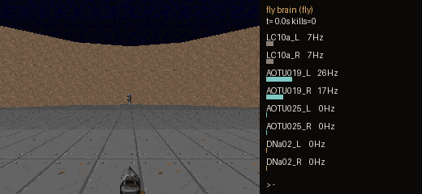

# FlyMario



*The real FlyWire LC10a -> AOTU -> DNa02 circuit (3,963 LIF neurons, no
training) turning toward and shooting enemies in ViZDoom (one episode, 7
kills; the average over 20 held-out episodes is 8.0). Right panel: live
firing rates of the readout neuron groups. See `docs/MARKSMAN.md`.*


Use the *Drosophila* whole-brain connectome (FlyWire) as a spiking neural
network and see what it can do in games: run real wiring forward with no
training (Fly Marksman, the main positive result), and train it with a
dopamine-based (three-factor) learning rule modeled on the fly mushroom body
(platformer, FlappyBird, Pong; none beats a simple baseline convincingly).

The project started as "fly brain plays Super Mario Bros", hence the name.
Real Mario never ran here: `nes-py` needs a C++ toolchain this machine
doesn't have (see "Mario environment install notes"). The Mario code path
exists and runs on the toy connectome only.

This is a research/education project, not a competitive game bot. See
`docs/PLAN.md` for the full write-up of the approach, the biological
simplifications made, and the milestones. Short version:

- The **mushroom body** (Kenyon cells → MBONs, gated by dopamine neurons)
  is the one part of the fly brain with a well-established, experimentally
  grounded learning rule. We use it, faithfully, as a value/critic circuit.
- Turning "how good is this situation" into "which button to press" is
  **not** something the fly connectome does on its own — we add a small
  actor layer on top and say so explicitly (see `learning/actor.py`).
- Everything else (photoreceptors → optic lobe → descending neurons) is
  used as a fixed, non-plastic feature extractor / motor decoder, in line
  with what's actually known about those circuits.

## Results at a glance

| Experiment | Result | Verdict |
|---|---|---|
| Simulator validation | Reproduces the published sugar -> MN9 feeding result on the full 138,639-neuron connectome | Validated |
| Fly Marksman (untrained real wiring, ViZDoom) | Held-out, 20 episodes: **8.0 +/- 5.2 kills** vs 0.0 scrambled wiring, 1.0 recalibrated scramble, 1.05 random, 12.4 oracle (fly vs scrambled p = 1.5e-6, vs random p = 9e-6). Silencing AOTU019+025: 0.0; AOTU025 alone: 7.85 (no effect). At 35 mV drive: 9.05 held-out (not significantly above 8.0) | Wiring matters; reproduces the published direction |
| Pong, dopamine rule (10 seeds) | 2.8% sampled, 0.0% greedy, vs 3.1% for random play | No learning shown |
| Pong, hybrid fixed encoding + Q-head (6 seeds) | 2.8 +/- 3.2% (bimodal), vs 3.1% random | No learning shown |

Details and caveats: `docs/MARKSMAN.md` (including a drive-strength sweep
where an untuned parameter first hid the effect) and `docs/PONG.md`.
Pong uses a synthetic 242-neuron circuit; Marksman uses real FlyWire wiring
(3,963 neurons) with engineered vision input and no learning.

## Project layout

```
flymario/
  data/            connectome files (downloaded, gitignored)
  connectome/      download + load connectivity into a sparse weight matrix
  sim/             leaky integrate-and-fire spiking simulator (torch)
  interface/       game screen/state -> sensory input, DN spikes -> buttons
  learning/        dopamine three-factor rule (mushroom body) + actor-critic
  env/             Super Mario Bros gym wrapper + reward shaping
  experiments/     configs and training entry points
  tests/           unit tests, including the toy-conditioning sanity check
```

## Setup

```bash
pip install -r requirements.txt
```

`torch` is CPU-only by default (see requirements.txt); swap in a CUDA build
if you have a GPU. `gym-super-mario-bros`/`nes-py` need a C/C++ toolchain to
build on some platforms (notably Windows) — if that install fails, the rest
of the pipeline (connectome, simulator, learning rule, toy-conditioning
tests) still works and can be validated independently. See
"Mario environment install notes" below.

## Getting the connectome

```bash
python -m connectome.download --dest data/
```

This fetches the pre-built connectivity table from Shiu et al. 2024's
whole-brain model (`philshiu/Drosophila_brain_model`), which is much smaller
and easier to work with than raw FlyWire exports and has already been
validated against real experiments. Raw FlyWire Codex downloads
(`neurons.csv`, `connections.csv`, `classification.csv`) are also supported
— see `connectome/download.py --source flywire`.

## Quickstart: reproduce the sugar -> feeding sanity check

Before touching Mario at all, confirm the simulator + connectome are wired
up correctly:

```bash
python -m tests.check_sugar_feeding
```

## Quickstart: toy conditioning (M1 milestone)

Validates the dopamine three-factor rule on a tiny two-odor circuit,
independent of the full connectome and of Mario:

```bash
python -m tests.toy_conditioning
```

## Visualizing brain activity

To see which real neurons actually fire and watch activity spread from the
sugar-sensing neurons to the feeding motor neuron MN9 (the same experiment
`tests/check_sugar_feeding.py` validates, run on a 2-hop subcircuit so it's
fast):

```bash
python -m analysis.record_sugar_activity   # simulates, writes analysis/sugar_activity.npz
python -m analysis.build_viz_data          # writes analysis/brain_activity.json
```

Then open `viz/index.html` (published as a Claude Artifact alongside
`analysis/brain_activity.json`) — it plays back the real 300ms simulated
response as an animated graph: node size/glow = spike activity, color =
sugar-sensing / relay / MN9, with a scrubber to step through time bin by
bin and click-to-inspect for each neuron's real FlyWire root ID.

There's also a 3D view, `viz/brain3d.html`: a real public 3D reconstruction
of the adult fly brain (VirtualFlyBrain's JFRC2 template domain meshes, CC
BY 4.0), with the **gnathal ganglion (GNG)** — the modern name for the
subesophageal zone, where gustatory/sugar afferents arrive and where
feeding motor neurons like MN9 sit — highlighted and pulsing in sync with
the real per-bin spike count from the same simulation. It needs two more
downloads first (done once, saved under `data/brain_mesh/`, see
`analysis/build_brain_mesh.py`'s docstring for the exact source URLs) and
then:

```bash
python -m analysis.build_brain_mesh          # writes analysis/brain_mesh.json
python -m analysis.build_activity_timeline   # writes analysis/activity_timeline.json
```

This view shows a real anatomical region, not real per-neuron 3D positions
— FlyWire's own neuron coordinates need a Codex account this project
doesn't have yet. See `docs/STATUS.md`.

## Watch the agent play

Since the real Mario environment can't run here (see below), there's a
self-contained demo that trains the real dopamine three-factor rule and
TD actor-critic on an original small platformer and replays the result:

```bash
python -m experiments.train_platformer   # writes analysis/platformer_run.json
```

Then open `viz/platformer_play.html` (published as a Claude Artifact
alongside `analysis/platformer_run.json`) — pick between the agent's first
episode, its best run (a real, recorded win), and a typical run late in
training, and watch it play back frame by frame with a live readout of
value, dopamine, and active Kenyon cells. Current result: 57 real wins out
of 2500 training episodes (2.3%) — genuine but partial learning, not yet a
reliably solved level. See `docs/STATUS.md` for what that partial result
does and doesn't mean.

## FlappyBird: an honest negative result

A second, harder game, on the same real learning pipeline:

```bash
python -m experiments.train_flappybird   # writes analysis/flappybird_run.json
```

Then open `viz/flappybird_play.html` (published as a Claude Artifact
alongside `analysis/flappybird_run.json`). Unlike the platformer, this
**did not work**: the agent passed zero pipes in 2000 episodes. A real bug
(unnormalized Kenyon-cell activity destabilizing the value function and
saturating the actor's weights within ~50 episodes) was found and fixed
along the way, but the task still didn't converge in the time budgeted —
a genuine finding about the limits of this simple linear actor-critic on a
continuous-tracking task, not a discrete one-shot decision like the
platformer's gap jump. A hand-coded reference policy is included in the
same visualization to show the game itself is solvable. See
`docs/STATUS.md` for the full account.

## Pong: real Atari, native interface, live
> **Note:** the Pong agents use a synthetic 242-neuron toy circuit, not
> FlyWire data, and neither beats random play (frozen evaluation: random
> 3.1%, dopamine 2.8%, hybrid 2.8%). See `docs/PONG.md`.

The real game, downloaded for real, played through its own unmodified
interface — no hand-crafted features, no remapped actions, no reshaped
reward — watched live, not replayed from a precomputed file. Full account
(research, bugs found and fixed, honest result) in **`docs/PONG.md`**.

```bash
python -m connectome.download --source brain-mesh --dest data/   # one-time
python live/build_assets.py                                       # one-time
python run_live_demo.py
```

Opens three browser tabs against one local server that's actually running
the real emulator and the real agent right now:

- **Game** — the real emulator screen, streamed live (MJPEG, not polled
  images — see `docs/PONG.md` for why that distinction is what actually
  fixed the earlier stutter), with a 0.1x–4x speed control and pause
  (button or the `P` key) so you can actually watch the ball and the fly's
  reactions.
- **Fly** — a hand-built anatomical fly model (translucent "x-ray" style)
  with a leg pressing the real up/down control, plus its live value
  estimate, dopamine signal, exploration rate, and running score rate.
- **Brain** — a REAL 3D reconstruction of the fly brain (rotate/zoom), with
  the right optic lobe (medulla + lobula — the actual visual
  motion-detection circuitry) highlighted and pulsing with live activity.

`game.html`/`fly.html` are fully offline-capable (no CDN dependencies);
`brain.html` loads three.js from a CDN for its 3D view, so needs internet
on first load. Stop the demo with Ctrl+C in the terminal running it.

`difficulty=0` (kept explicit in `env/pong_env.py`, not just the default)
is empirically the hardest of Pong's 4 built-in settings — a random policy
scores 0/15 against it vs. up to 13% at the easiest setting — the closest
thing to "the perfect bot" this game exposes.

For a one-shot training run instead of the live demo:
`python -m experiments.train_pong [--target-steps N]` (writes
`analysis/pong_run.json` and a checkpoint). Two real results, at very
different scales:

- **100K steps** (400 episodes): 18/400 scored (4.5%), close to the
  measured ~5% random-policy baseline.
- **2,000,000 steps** (7,402 episodes, 10.5 min): the policy froze for the
  first ~22% of episodes (0% score, identical repeated behavior — the same
  pattern first found on FlappyBird), then broke out and started scoring
  1-6% of points — but **140/7,402 overall (1.89%) is below both the
  shorter run and the random baseline**. Training 20x longer did not
  produce a better result here, and the extended frozen phase made the
  aggregate worse.
- **Same 2,000,000 steps, with frame stacking added** (network sees the
  last 2 raw RAM frames, not 1 — it previously had no way to tell which
  direction the ball was moving): **188/7,339 (2.56%)**, a real
  improvement over the un-stacked run, and the early freeze was less
  complete (1.13% in the first ~1,500 episodes instead of exactly 0%).
  Still below the ~5% random baseline. A genuine fix for a real
  information gap, kept.
- **Same again, plus a textbook-correct policy-gradient actor update**
  (tried because the original update never adjusted for the fact that
  reinforcing one action under a softmax should discourage the others —
  see `docs/PONG.md`): a short diagnostic looked healthier, but the full
  2M-step run scored **1/7,806 (0.013%)** — frozen almost immediately and
  never recovered, dramatically worse than frame stacking alone.
  **Reverted.** A more theoretically correct update isn't automatically a
  better one for this setup; kept in `learning/actor.py` as an opt-in,
  off-by-default option and a documented negative result, not deleted.
- **Three-seed comparison** (`--seed`, added specifically to stop drawing
  conclusions from single runs), 700K steps each: **0.94%, 0.49%,
  3.26%** — a 6.7x range from identical code, only the seed different.
  This means the frame-stacking "improvement" above (a 0.67-point gap,
  one run each) is within normal seed noise and isn't actually
  established; the policy-gradient failure (0.013%) is far below even
  the worst seed here, so that revert still stands. See `docs/PONG.md`
  for the full, honest reassessment.

## Other game environments

Real Mario needs `nes-py`, which needs a C/C++ compiler this environment
doesn't have (see below). Verified working here without any compiler:

- **Atari, via `ale-py`** — 104 real games (Pong, Breakout, Freeway, ...).
  `pip install ale-py "autorom[accept-rom-license]"`, then
  `AutoROM --accept-license`. If that fails with a network error even
  though your network is fine, see the note in `requirements.txt` — it's a
  `requests`-library quirk in some sandboxes, not a real connectivity
  problem; fetching the same URL with `urllib` works.
- **`flappy-bird-gymnasium`** — pure Python, no ROM or compiler at all.
- **`minigrid`**, **`gymnasium[box2d]`** (LunarLander, BipedalWalker) — also
  verified installable, not yet wired into this project's pipeline.

`stable-retro`/`gym-retro` and `procgen` are NOT installable via pip here
(no prebuilt wheels found) — don't spend time on those without a from-
source build.

## Running Mario training (blocked)

```bash
python -m experiments.train --config experiments/m2_config.yaml
```

Needs `gym-super-mario-bros`/`nes-py` installed (see below). With
`connectome.source: shiu` it also needs FlyWire Codex `classification.csv`,
which this project doesn't have; `connectome.source: toy` runs without it.
No Mario result has been produced.

## Mario environment install notes

`nes-py` compiles a C++ extension. On Windows you need the "Desktop
development with C++" workload from the Visual Studio Build Tools
installed, or run everything under WSL2 (recommended in the plan). If you
can't get it installed:

- `env/mario_env.py` will raise a clear `ImportError` naming the missing
  package instead of failing silently elsewhere.
- Everything upstream of the environment (connectome, `sim/`, `learning/`)
  has its own tests that don't depend on `gym-super-mario-bros` at all, so
  development can continue while that install is sorted out.

## Status

See `docs/STATUS.md` for what's implemented vs. still to do against the
milestones in `docs/PLAN.md`.

## Hybrid Pong and Fly Marksman

See `docs/MARKSMAN.md` (untrained real-wiring circuit playing ViZDoom, with a
scrambled-wiring control) and `learning/qhead.py` (fixed connectome-derived
encoding plus a trained Q-head).

## Credits and licenses

Code: MIT (see `LICENSE`). Third-party data is downloaded at setup time and
not redistributed here:

- FlyWire connectome v783 connectivity tables: Dorkenwald et al. 2024;
  Shiu et al. 2024 (`philshiu/Drosophila_brain_model`).
- Brain meshes: VirtualFlyBrain JFRC2 template, CC BY 4.0.
- Fly Marksman circuit definition: `webergithub/fruitfly-lab`; the neuron list
  is theirs, the wiring extraction and controller here are independent.
- Game environments: Atari Learning Environment (ale-py) and ViZDoom.
